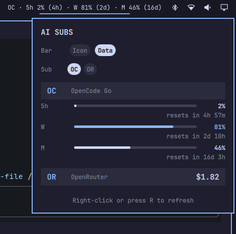
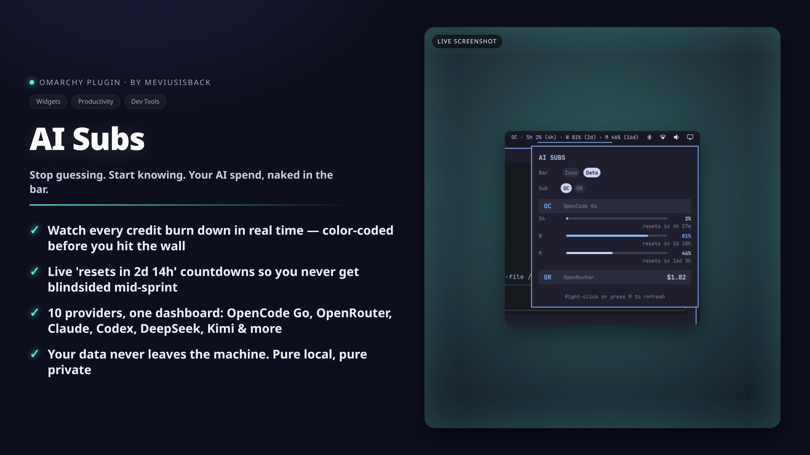

<div align="center">

# AI Subs

**AI subscription usage and balance in the Omarchy bar — meter bars, credit balances and live reset countdowns for every provider you have configured.**

[](LICENSE)





</div>

## Why

AI spend is scattered across a dozen subscriptions, each with its own dashboard, window and reset clock. AI Subs collapses all of it into a single bar chip: one glance tells you which subscription is hot, which is exhausted, and when each one resets — with a panel behind it for the details and the settings.

## Features

- **Meter bars per limit window** — each subscription gets its own segmented bar(s): weekly vs monthly (opencode), 5h vs 7-day (Claude and Codex), credits vs requests, per-model where the vendor exposes it. Color-coded thresholds: green (< 70%), orange (70–90%), red (> 90%).
- **Flexible credit accounting** — prepaid **balances** (OpenRouter key, directly usable dollars; `hermes` and `amp` via `npx` CLIs with `--non-interactive`), **promotional credits** (Qwen, Kimi, Minimax, iFlow, DeepSeek, OpenRouter key endpoint with 7-day cache), and Gate subtokens (per-day fallback, configurable multiplier for failed calls).
- **Live reset countdowns** — every bar shows time to reset: `(2d)`, `(2h)`, `(16m)`, `(4d 1h)`, per-window and per-provider. Codex weekly resets Wednesday 00:00 UTC; Claude resets exact `resets_at` timestamps, otherwise deterministic countdowns. Hourly-refreshing subscriptions interpolate usage between sparse snapshots so the meter never jumps.
- **Two bar display modes** — `Icon` (default): `Σ` glyph with 5h peak + the worst active window; `Data`: full one-liner (`OC · 5h 0% (4h) · W 79% (2d) · M 46% (16d)`). Hide the icon with `hidden` to suppress clutter.
- **DeepSeek peak/off-peak indicator** — optional clock next to the Sub box: **PEAK** during Mon–Fri 01:00–04:00 and 06:00–10:00 UTC, **OFF** the other 17 weekday hours, weekends and Chinese public holidays, **OFF BY DEFAULT** — no key required, plain UTC windows + cached public-holiday list.
- **Settings live in the panel** — Bar: `Icon`/`Data`; Sub: selector that lists only the subscriptions actually configured; Clock: `Deepseek Off`/`On`. Persisted to `shell.json` via `bar.set`, instant, no restart.
- **Clean by default** — subscriptions with no keys never appear: no `---` placeholders, no config-file crimes. Qwen OAuth regional endpoints resolved from the token; Kimi/MiniMax/iFlow/DeepSeek default to international endpoints with CN override.

Not supported, deliberately: Gemini web subscriptions (no public usage API), OpenCode Zen credits (only Agent API, usable balance endpoint requested upstream).

## Install

```bash
omarchy plugin add https://github.com/meviusisback/omarchy-ai-subs.git --enable --yes
```

or interactively (you pick the flags):

```bash
omarchy plugin add https://github.com/meviusisback/omarchy-ai-subs.git
```

Then add the API keys for the providers you use to `~/.hermes/.env`, one per line:

```bash
OPENAI_API_KEY=sk-...
ANTHROPIC_API_KEY=sk-ant-...
```

Providers appear in the widget as soon as their key exists — no restart needed (the fetcher refreshes every 15 minutes; click the icon or press `R` for an immediate refresh).

## Usage

- Click the bar icon to open the panel.
- **Bar** box: switch between `Icon` and `Data` display.
- **Sub** box: pick which subscription drives the bar chip (lists only the subscriptions actually configured).
- **Clock** box: `Deepseek Off` / `Deepseek On` for the peak/off-peak indicator.
- `R` refreshes; right-click the bar icon also refreshes.

Same settings from the terminal:

```bash
omarchy-shell shell bar.set meviusisback.ai-subs barDisplay Data
omarchy-shell shell bar.set meviusisback.ai-subs defaultSub claude
omarchy-shell shell bar.set meviusisback.ai-subs barDisplay hidden
omarchy-shell shell bar.set meviusisback.ai-subs dsPeakClock true
```

## Requirements

- Omarchy with the Quickshell shell
- `python3` (the fetcher uses the standard library only)
- Internet access (vendor usage/balance APIs; the Nager.Date public-holiday API only while the pricing clock is on)
- API keys in `~/.hermes/.env` (or the native config each provider reuses)
- `gh` CLI logged in — Copilot subscription detection only (opt-in)
- Cursor local state files — Cursor subscription only (opt-in)

## Configuration

Settings (panel dropdowns or `bar.set`), with defaults:

| Key | Default | Options |
|---|---|---|
| `refreshIntervalSec` | `900` | seconds, 30–3600 |
| `hermesEnvFile` | `~/.hermes/.env` | `KEY=value` lines |
| `barDisplay` | `Icon` | `Icon`, `Data`, `hidden` |
| `dsPeakClock` | `false` | `true` / `false` |
| `defaultSub` | `opencode` | `opencode`, `codex`, `claude`, `copilot`, `cursor`, `antigravity`, `qwen`, `kimi`, `minimax`, `iflow`, `deepseek`, `openrouter`, `gate`, `hermes`, `amp` |

Provider → key mapping (first found wins; keys read from `hermesEnvFile`, then the native file):

| Provider | Metric | Key (env file) | Native fallback |
|---|---|---|---|
| opencode (incl. Zen) | weekly + monthly windows, balance | `OPENCODE_API_KEY` | `~/.local/share/opencode/auth.json` |
| codex | 5h + weekly, balance | `OPENAI_API_KEY` | `~/.codex/auth.json` |
| claude | 5h session, 7d week, Sonnet-only week | `ANTHROPIC_API_KEY`, `ANTHROPIC_OAUTH_TOKEN` | `~/.claude/.credentials.json` |
| copilot | premium + chat/completions % | `GH_TOKEN`, `GITHUB_TOKEN`, `GH_PAT` | `gh` CLI (`:copilot` suffix) |
| cursor | credits + invoice cents (+ team overage) | `CURSOR_API_KEY` | `~/.cursor Chinese locale DB` |
| antigravity | credits + remaining % | `GOOGLE_ACCESS_TOKEN` (oauth creds file) | managed OAuth creds path |
| qwen | credits + subscription days | `QWEN_API_KEY`, `DASHSCOPE_API_KEY` | `~/.qwen/oauth_creds.json` |
| kimi | balance + 7d cache promo | `KIMI_API_KEY` | — |
| minimax | balance + 7d cache promo | `MINIMAX_API_KEY` | — |
| iflow | quota total/used | `IFLOW_API_KEY` | — |
| deepseek | balance | `DEEPSEEK_API_KEY` | — |
| openrouter | key + promo + total (99-req pages, `limit:200`) | `OPENROUTER_API_KEY` | — |
| gate | per-day subtoken counts | `GOOGLE_GATE_API_KEY` | — |
| hermes | balance + Tier 4 (`$50 + 15%`) | `HERMES_API_KEY` | — |
| amp | credits (`npx @sourcegraph/amp --non-interactive`) | `AMP_API_KEY` | — |

Key files stay locked down:

- Key files must be `0600` (or `0400`), owned by you, single hard link — otherwise the fetch fails closed.
- Explicit refusals: group/other-readable keys, root-owned keys even at `0600`, symlinked/confusing `.env` paths, missing file (clean error, treated as no keys).
- You own the chmod: recovery is `chmod 600 ~/.hermes/.env`, never an automatic fix.
- Process titles hide key fragments (`setproctitle` when available, `****` + last-4 fallback).
- `--redact`: replace all key-shaped strings with `****` across the whole pipeline — the only string passed between collector and widget.

## How it works

`fetch_usage.py` queries each vendor's own usage/balance endpoint in parallel and emits one JSON document; `Panel.qml` renders the meters, balances and countdowns from it. Credential sources, in order: dedicated `*_API_KEY` env vars (including `*_API_FILE` indirect-file support, root-owned files refused) → `~/.hermes/.env` → provider-native OAuth/credential files. No API keys, balances or usage data ever leave your machine except to the vendors' own API endpoints (and Nager.Date for the holiday list when the pricing clock is on).

Verify with `python3 -m unittest discover -s tests` — 77 tests, hermetic.

## Removal

```bash
omarchy plugin update meviusisback.ai-subs --yes   # update
omarchy plugin remove meviusisback.ai-subs --yes   # remove
```

## License

MIT — see [LICENSE](LICENSE).
